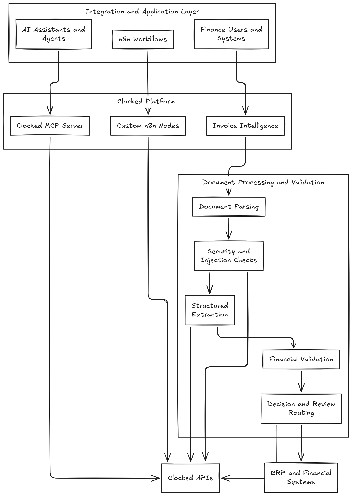

# Clocked Platform

**A unified ecosystem for Clocked AI integrations, intelligent document processing, and workflow automation.**

Clocked Platform brings together three complementary projects: a Model Context Protocol (MCP) server, custom n8n integration nodes, and an AI-powered invoice intelligence application.

The platform enables AI applications and automation workflows to interact with Clocked APIs for structured data extraction, decision-making, document processing, security validation, and intelligent workflow orchestration.

Rather than maintaining separate repositories for each integration, Clocked Platform organizes these projects into a single monorepo while allowing each project to retain its own dependencies, development workflow, testing strategy, and deployment lifecycle.

---

## Table of Contents

- [Overview](#overview)
- [Key Features](#key-features)
- [Projects](#projects)
- [Architecture](#architecture)
- [How the Projects Work Together](#how-the-projects-work-together)
- [Demo](#demo)
- [Repository Structure](#repository-structure)
- [Technology Stack](#technology-stack)
- [Prerequisites](#prerequisites)
- [Getting Started](#getting-started)
- [Project-Specific Setup](#project-specific-setup)
- [Configuration and Environment Variables](#configuration-and-environment-variables)
- [Invoice Intelligence Workflow](#invoice-intelligence-workflow)
- [Security and Validation](#security-and-validation)
- [Development Guidelines](#development-guidelines)
- [Testing](#testing)
- [Deployment](#deployment)
- [Versioning and Releases](#versioning-and-releases)
- [Troubleshooting](#troubleshooting)
- [Contributing](#contributing)
- [License](#license)

---

## Overview

Clocked Platform is a collection of AI integration and application projects built around the Clocked API (https://clocked.rezolve.ai/) ecosystem.

The repository brings together three projects with distinct responsibilities.

| Project | Purpose | Primary Users |
|---|---|---|
| **Clocked MCP Server** | Exposes Clocked capabilities through the Model Context Protocol. | AI assistants, agents, and MCP-compatible clients |
| **n8n Nodes for Clocked** | Integrates Clocked API operations into n8n workflows. | Automation engineers and workflow developers |
| **Clocked Invoice Intelligence** | Implements an intelligent invoice processing application. | Finance teams, developers, and enterprise automation teams |

### The vision

Make Clocked AI capabilities accessible through multiple integration surfaces:

- **AI clients:** Access Clocked capabilities through MCP.
- **Workflow automation:** Build visual automations using custom n8n nodes.
- **Business applications:** Apply Clocked capabilities to invoice processing and financial document workflows.

Each project can be developed and deployed independently, while the shared repository provides a unified location for source code, documentation, examples, and future integrations.

---

## Key Features

### 1. AI Integration Through MCP

The Clocked MCP Server provides an integration layer between compatible AI clients and supported Clocked API capabilities.

Depending on the implemented tools and configuration, this integration can support:

- Structured information extraction.
- AI-assisted decision-making.
- Document processing operations.
- Security and validation workflows.
- Reusable AI capabilities exposed through MCP tools.

The server acts as an integration layer rather than replacing the underlying Clocked APIs.

### 2. Workflow Automation with n8n

The `n8n-nodes-clocked` project provides custom n8n nodes for invoking Clocked APIs directly from visual workflows.

The integration is designed to make AI capabilities available within existing automation pipelines without requiring every workflow to implement its own HTTP integration logic.

Potential benefits include:

- Reusable workflow operations.
- Centralized API authentication configuration.
- Structured request and response handling.
- Easier integration with webhooks and external systems.
- Support for multi-step business processes.
- Simplified workflow development and maintenance.

### 3. Intelligent Invoice Processing

The `clocked-invoice-intelligence` project applies AI-assisted processing to invoice documents.

The intended processing pipeline combines document parsing, structured extraction, security checks, financial validation, and decision-making.

Depending on the implemented workflow, the system can help:

- Extract invoice fields into structured JSON.
- Process supported PDF, image, or structured invoice formats.
- Identify potentially malicious document instructions.
- Validate extracted values against business rules.
- Reconcile line items, subtotals, taxes, and invoice totals.
- Identify discrepancies requiring human review.
- Return structured processing results to downstream systems.

Financial validation should use deterministic calculations and explicit business rules wherever possible. AI-generated interpretations should not replace accounting controls.

---

## Projects

### 1. Clocked MCP Server

**Directory:** `clocked-mcp-server/`

The MCP server provides a standardized integration surface for exposing Clocked capabilities to compatible AI applications.

#### Responsibilities

- Connect MCP clients to supported Clocked API operations.
- Translate tool inputs into appropriate API requests.
- Validate inputs before executing operations.
- Handle API errors and return structured responses.
- Keep API credentials on the server side.
- Expose only the tools enabled by the implementation and configuration.

#### Example use cases

- An AI assistant extracts structured fields from a document.
- An AI agent invokes a supported Clocked decision-making operation.
- An MCP-compatible application incorporates Clocked capabilities into a larger workflow.

#### Documentation

See [`clocked-mcp-server/`](./clocked-mcp-server/) for implementation details, installation instructions, available tools, and supported transports.

---

### 2. n8n Nodes for Clocked

**Directory:** `n8n-nodes-clocked/`

The custom n8n node package integrates Clocked APIs into n8n workflow automation.

Instead of manually constructing HTTP requests for each Clocked operation, developers can configure the appropriate node within the n8n editor.

#### Supported operation categories

The integration is designed to support the following Clocked capabilities, subject to the operations implemented in the current package version.

| Operation | Purpose |
|---|---|
| **Decide** | Evaluate information against instructions, criteria, or decision rules. |
| **Extract** | Extract structured information from supplied content. |
| **Fill** | Populate structured fields using available source information. |
| **PII Protection** | Support the identification or protection of personally identifiable information. |
| **Injection Guarding** | Inspect content for potentially malicious or instruction-injection attempts. |
| **Script Inspection** | Inspect supported content for potentially unsafe scripts. |
| **Grounding Verification** | Verify supported outputs against reference information. |
| **Document Comparison** | Compare documents or structured content for differences. |
| **Reranking** | Reorder candidate results according to relevance. |
| **Pipelines** | Integrate supported multi-step processing capabilities. |

The exact availability, input schemas, output formats, and API requirements depend on the implementation and the corresponding Clocked API contracts.

#### Integration capabilities

The node package is intended to provide:

- Operation-specific configuration.
- API credential management.
- Request construction and validation.
- Response processing.
- Error handling.
- Integration with other n8n nodes.
- Reusable workflows for common business processes.

#### Documentation

See [`n8n-nodes-clocked/`](./n8n-nodes-clocked/) for installation, credentials configuration, available operations, examples, and package publishing instructions.

---

### 3. Clocked Invoice Intelligence

**Directory:** `clocked-invoice-intelligence/`

Clocked Invoice Intelligence applies document processing and Clocked AI capabilities to invoice automation.

The project focuses on turning incoming invoice documents into structured, validated data that downstream financial systems can consume.

#### Core capabilities

**Document ingestion**

Accept invoice content through the interfaces supported by the application, such as file uploads, webhooks, or API requests.

**Document parsing**

Integrate a document parsing service, such as Unstructured, to extract text and structural elements from supported documents.

**Structured extraction**

Use Clocked Extract or another configured extraction mechanism to map invoice content into a defined schema.

**Security inspection**

Apply appropriate checks to identify potentially malicious document content before using extracted information in downstream AI operations.

**Business validation**

Apply deterministic rules to validate invoice fields and perform arithmetic checks.

**Decision-making**

Use configured decision-making logic to determine whether an invoice can proceed automatically or requires further review.

**Human review**

Route invoices with missing fields, conflicting values, failed validations, or insufficient confidence to an appropriate review process.

**Downstream integration**

Expose processing results to supported webhooks, APIs, workflow systems, or financial applications.

#### Example invoice fields

The extraction schema may include:

- Invoice number.
- Document reference number.
- Invoice date.
- Due date.
- Vendor name and details.
- Customer or bill-to information.
- Purchase order number.
- Currency code.
- Line items.
- Quantity and unit price.
- Subtotal.
- Tax amounts.
- Discounts.
- Total amount.
- Payment terms.

The actual schema should be defined by the application and the requirements of the target accounting or ERP system.

#### Documentation

See [`clocked-invoice-intelligence/`](./clocked-invoice-intelligence/) for application architecture, installation, environment variables, workflow definitions, and API documentation.

---

## Architecture

Clocked Platform separates integration interfaces from business applications.

The following diagram illustrates the intended relationship between the projects and the underlying Clocked APIs.




**Note:** This diagram represents the target integration architecture. Actual API calls, workflow ordering, and integration paths should match the implementation in each project.

### Architectural principles

1. **Separation of concerns:** Each project has a defined responsibility.
2. **Independent deployment:** Applications and integrations can be released separately.
3. **Reusable capabilities:** Clocked APIs can be accessed through different integration surfaces.
4. **Security by design:** Credentials, document inputs, and processing results require appropriate safeguards.
5. **Deterministic validation:** Financial calculations and critical business rules should be independently verifiable.
6. **Human oversight:** Exceptions should be routed for review when automated processing cannot establish a reliable result.

---

## How the Projects Work Together

The three projects serve different purposes but can complement one another.

### Scenario 1: AI assistant integration

An MCP-compatible AI client connects to the Clocked MCP Server.

1. The client discovers the tools exposed by the server.
2. The client invokes an available tool with structured inputs.
3. The server validates the request.
4. The server calls the corresponding Clocked API.
5. The server returns the response to the client.

This allows AI clients to use supported Clocked functionality without implementing each API integration themselves.

### Scenario 2: Automated business workflow

An n8n workflow invokes Clocked nodes as part of a business process.

1. A webhook or another configured trigger starts the workflow.
2. The workflow prepares the input.
3. A Clocked node invokes the appropriate API operation.
4. The workflow evaluates the response.
5. The result is routed to another node, an external system, or a review queue.

This approach is suitable for integrating Clocked capabilities into existing automation processes.

### Scenario 3: Invoice processing

An invoice enters the Invoice Intelligence application.

1. The application receives the invoice.
2. A document parser extracts text and structural information.
3. Security checks inspect relevant document content.
4. Clocked Extract produces structured invoice fields.
5. The application validates required fields and financial calculations.
6. Clocked Decide or equivalent configured logic evaluates the processing outcome.
7. The invoice is approved for the next configured processing step or routed for review.
8. The application returns a structured result and records appropriate processing information.

The exact processing order should be implemented according to the security requirements and the supported API contracts.

---

## Demo

See the Clocked Platform in action across its three projects.

### Clocked MCP Server


The MCP server playground demonstrates tool discovery and invocation against the Clocked API.


Reference documentation for MCP tools, transports, and supported capabilities.

### n8n Nodes for Clocked


The custom Clocked node appearing in the n8n editor, ready to be configured in a workflow.


An end-to-end invoice processing workflow built using the custom n8n nodes.

### Clocked Invoice Intelligence


The Invoice Intelligence web application interface for uploading and processing invoices.


Structured invoice parsing and extraction results displayed in the application.


Processing history and audit trail for invoices handled by the application.


Invoice being processed through the extraction and validation pipeline.


Invoice routed for human review when automated processing cannot establish a reliable result.

> **Note:** These screenshots illustrate the target user experience. Actual layouts, fields, and behavior should match the implementation in each project.

---

## Repository Structure

The repository follows a monorepo structure.

```text
clocked-platform/
│
├── clocked-mcp-server/
│   ├── src/
│   ├── tests/
│   ├── package.json
│   ├── .env.example
│   └── README.md
│
├── n8n-nodes-clocked/
│   ├── nodes/
│   ├── credentials/
│   ├── package.json
│   ├── tsconfig.json
│   └── README.md
│
├── clocked-invoice-intelligence/
│   ├── frontend/
│   ├── backend/
│   ├── workflows/
│   ├── tests/
│   ├── package.json
│   ├── .env.example
│   └── README.md
│
├── .gitignore
├── .editorconfig
├── README.md
└── LICENSE
```

This is an illustrative structure. Retain the actual directory layout of each project and update this diagram to reflect the repository as it evolves.

### Monorepo conventions

- Keep project-specific dependencies in their respective package manifests.
- Maintain individual README files.
- Store project-specific tests with the corresponding project.
- Avoid committing generated build artifacts or local dependencies.
- Keep environment-specific settings outside source control.
- Document shared interfaces and integration contracts explicitly.

---

## Technology Stack

The repository may use the following technologies, depending on the implementation of each project.

| Technology | Purpose |
|---|---|
| Node.js | JavaScript runtime for server-side applications and integrations |
| TypeScript | Type-safe development for supported Node.js projects |
| Model Context Protocol | Standardized integration between AI clients and MCP servers |
| n8n | Workflow automation |
| Clocked APIs | AI extraction, decision-making, and related processing capabilities |
| Next.js | Web application framework where used by Invoice Intelligence |
| Express.js | HTTP server framework where used by the backend |
| Unstructured | Document parsing and extraction of document elements |
| Git and GitHub | Source control, collaboration, and release management |
| Railway or another hosting provider | Application deployment, where configured |

The exact versions and dependencies should be taken from the individual projects' package manifests.

---

## Prerequisites

Before developing the projects, install the tools required by the relevant application.

Common prerequisites include:

- Git.
- Node.js, using a version supported by the project.
- npm or the package manager specified by the project.
- Access to the required Clocked APIs.
- An API key for the configured document parsing service, if used.
- n8n for testing custom nodes and workflows.
- An MCP-compatible client for testing the MCP server.

Additional prerequisites may be necessary for individual applications.

---

## Getting Started

### 1. Clone the repository

```bash
git clone https://github.com/YOUR_USERNAME/clocked-platform.git
cd clocked-platform
```

Replace `YOUR_USERNAME` with the GitHub username or organization that owns the repository.

### 2. Choose a project

Navigate to the project you want to develop.

For the MCP server:

```bash
cd clocked-mcp-server
```

For the n8n integration:

```bash
cd n8n-nodes-clocked
```

For Invoice Intelligence:

```bash
cd clocked-invoice-intelligence
```

### 3. Install dependencies

For a project with a `package.json` and npm lockfile:

```bash
npm ci
```

If the project does not have a compatible lockfile, use its documented installation procedure.

For projects with separate frontend and backend applications, install dependencies in each application directory when required.

### 4. Configure environment variables

Create the required local environment file using the project's `.env.example` as a reference.

For example:

```bash
cp .env.example .env
```

On Windows PowerShell, you can use:

```powershell
Copy-Item .env.example .env
```

The example file must exist in the directory where you run the command.

Populate the required environment variables using your own credentials. Never commit the populated `.env` file.

### 5. Run the project

Follow the scripts documented in the project's `package.json` and README.

For example, a project may provide:

```bash
npm run dev
```

or:

```bash
npm run build
npm start
```

These are common conventions, not guarantees. Use the actual scripts defined by the relevant project.

---

## Project-Specific Setup

### Clocked MCP Server

Navigate to the server directory:

```bash
cd clocked-mcp-server
```

Install dependencies:

```bash
npm ci
```

Configure the environment variables documented by the server.

Build and run the server using its available scripts.

```bash
npm run build
```

The server's MCP transport, supported tools, and client configuration should be documented in `clocked-mcp-server/README.md`.

### n8n Nodes for Clocked

Navigate to the node package:

```bash
cd n8n-nodes-clocked
```

Install dependencies:

```bash
npm ci
```

Build the package:

```bash
npm run build
```

Run the available tests:

```bash
npm test
```

If the package does not define a test script, use its documented test procedure.

To test the custom node, follow the project's instructions for installing or linking the package into a compatible n8n instance.

Before publishing the package, verify its package metadata, build output, credentials configuration, and operation definitions.

### Clocked Invoice Intelligence

Navigate to the application directory:

```bash
cd clocked-invoice-intelligence
```

Install the dependencies using the project's package manager.

Configure the application environment, including any required Clocked API credentials and document parsing credentials.

Build the application:

```bash
npm run build
```

Run the development server using the available development script.

If the application has separate frontend and backend directories, follow their individual setup instructions.

**Important:** These commands are examples. The actual project scripts and directory structure take precedence.

---

## Configuration and Environment Variables

Each project should document its required configuration in its own `.env.example` file.

Depending on the implementation, configuration may include the following variables.

| Variable | Purpose | Required |
|---|---|---|
| `CLOCKED_API_KEY` | Authenticates requests to the Clocked API | If required by the API integration |
| `CLOCKED_BASE_URL` | Specifies the configured Clocked API base URL | If configurable |
| `UNSTRUCTURED_API_KEY` | Authenticates requests to Unstructured | If the service is used |
| `PORT` | Configures the HTTP server port | Depends on the application |
| `NODE_ENV` | Identifies the runtime environment | Depends on the application |

These names are examples. Use the actual variable names supported by the project code and API contracts.

### Configuration best practices

- Keep credentials outside source control.
- Use different credentials for development, staging, and production.
- Store production secrets in the hosting platform's secret manager.
- Validate required configuration at application startup.
- Avoid logging API keys, authorization headers, or sensitive document contents.
- Rotate exposed credentials immediately.
- Use least-privilege credentials wherever supported.

---

## Invoice Intelligence Workflow

The invoice processing workflow is intended to transform unstructured invoice content into validated, structured data.

### Processing stages

#### Stage 1: Invoice ingestion

Accept an invoice through a supported interface.

Possible input formats include:

- PDF invoices.
- Image-based invoices.
- Digitally generated invoices.
- Structured invoice formats supported by the application.

Validate file types, file sizes, and other input constraints before processing.

#### Stage 2: Document parsing

Use the configured document parsing service to extract text and, where available, structural elements such as tables and coordinates.

The parsed output becomes the input for subsequent extraction and validation stages.

#### Stage 3: Security inspection

Inspect untrusted content for potential prompt injection or other malicious instructions.

Document text must be treated as untrusted input. Instructions embedded in an invoice must not override system instructions, application policies, or financial approval rules.

Security checks should be enforced in the application workflow, not merely described in prompts.

#### Stage 4: Structured extraction

Extract the required invoice fields into a defined schema.

For example:

```json
{
  "invoice_number": "INV-10025",
  "invoice_date": "2026-10-15",
  "vendor_name": "Example Supplier",
  "currency_code": "USD",
  "subtotal": 1000.00,
  "tax_amount": 100.00,
  "invoice_total": 1100.00
}
```

This is an illustrative example, not a real invoice or a guaranteed response schema.

The application should define how missing values, ambiguous fields, invalid dates, and extraction confidence are represented.

#### Stage 5: Financial validation

Validate extracted financial values independently of the AI extraction result.

Depending on the invoice schema and business rules, checks may include:

- Line-item extensions.
- Subtotal reconciliation.
- Tax calculations.
- Discounts.
- Shipping and additional charges.
- Currency consistency.
- Invoice total reconciliation.
- Purchase order matching.

For example:

`Expected total = subtotal + tax + additional charges - discounts`

The formula must be adapted to the applicable invoice rules. Rounding tolerances, tax treatments, and other adjustments must be explicitly defined.

All validation outputs and review reasons should derive from the same verified calculation results.

#### Stage 6: Decision and review routing

Evaluate the processing outcome against configured business rules.

Possible outcomes include:

- Ready for downstream processing.
- Requires human review.
- Missing required information.
- Financial discrepancy detected.
- Security inspection failed.
- Processing failed.

An AI decision must not independently authorize payment or override mandatory accounting controls.

#### Stage 7: Response and integration

Return the processing result through the application's supported response mechanism.

The response should distinguish successful processing from processing errors and identify invoices that require further review.

Where supported, retain a processing identifier and relevant audit information to help troubleshoot failures and prevent duplicate processing.

---

## Security and Validation

Security is a core requirement for any application processing financial documents and external API requests.

### API credential protection

- Never commit API keys or production credentials.
- Store secrets in environment variables or an approved secret manager.
- Avoid including secrets in error messages or logs.
- Restrict access to production credentials.

### Document security

- Treat uploaded files and extracted document content as untrusted.
- Validate file types, sizes, and processing limits.
- Inspect document content before using it in sensitive AI operations.
- Prevent document instructions from changing application security policies.
- Do not execute scripts or embedded instructions found in documents.

### Financial controls

- Validate amounts using deterministic calculations.
- Apply explicit rounding and currency rules.
- Reconcile extracted values against source data where possible.
- Route unresolved discrepancies for human review.
- Do not treat model confidence as proof of financial correctness.

### API reliability

- Apply appropriate request timeouts.
- Handle rate limits and transient failures.
- Use bounded retries with backoff where appropriate.
- Reuse request identifiers when supported by the API's idempotency contract.
- Avoid retrying non-idempotent operations blindly.
- Return meaningful errors without exposing internal secrets.

### Logging and auditability

Record appropriate operational metadata, such as:

- Processing identifiers.
- Workflow stages.
- Operation status.
- Error categories.
- Validation outcomes.
- Review reasons.
- Processing timestamps.

Avoid retaining complete invoices or sensitive personal information in logs unless there is an approved business requirement and appropriate access controls.

---

## Development Guidelines

### Code organization

- Keep each project's source code in its own directory.
- Maintain clear boundaries between application and integration code.
- Reuse shared functionality only when a genuine common requirement exists.
- Avoid introducing unnecessary cross-project dependencies.

### TypeScript and JavaScript

Where applicable:

- Use consistent formatting and linting.
- Validate external inputs.
- Handle asynchronous failures explicitly.
- Prefer typed request and response structures.
- Keep API contracts documented.
- Avoid exposing internal exceptions to external callers.

### Git workflow

Use feature branches for development.

Example:

```bash
git checkout -b feature/improve-invoice-validation
```

Commit changes:

```bash
git add .
git commit -m "Improve invoice validation"
```

Push the branch:

```bash
git push -u origin feature/improve-invoice-validation
```

Open a pull request for review before merging into the protected main branch.

### Commit message conventions

Prefer descriptive messages, such as:

- `feat: add invoice validation rule`
- `fix: handle Clocked API timeout`
- `docs: update MCP server setup`
- `test: add invoice extraction tests`
- `refactor: improve request validation`

These are examples; adopt the convention that best fits the team.

---

## Testing

Each project should have its own test strategy.

### Clocked MCP Server

Test:

- Tool registration and discovery.
- Input validation.
- API request construction.
- Authentication failures.
- API timeout handling.
- Error responses.
- Supported MCP transports.

### n8n Nodes for Clocked

Test:

- Operation selection.
- Credential handling.
- Request payload construction.
- Response processing.
- Invalid input handling.
- API error handling.
- Compatibility with the supported n8n version.

### Clocked Invoice Intelligence

Test:

- Document ingestion.
- Extraction schema validation.
- Missing and malformed fields.
- Financial calculations.
- Security inspection outcomes.
- Review routing.
- Duplicate request handling.
- Webhook response behavior.
- Failure recovery.

Use mocked API responses for unit tests where appropriate. Use controlled integration tests to verify compatibility with external services.

Never use real production credentials or sensitive production invoices in ordinary development tests.

---

## Deployment

Clocked Platform is a monorepo, but each project can have its own release and deployment process.

### Clocked MCP Server

Deploy the server as an independent service using a hosting environment compatible with its runtime and MCP transport.

Configure the required environment variables and ensure that the selected transport is supported by the intended MCP clients.

### n8n Nodes for Clocked

Build and package the custom node project.

Publish it to npm or distribute it through an appropriate private package mechanism, depending on the intended audience and access requirements.

Maintain compatibility with the supported n8n versions and document installation and upgrade procedures.

### Clocked Invoice Intelligence

Deploy the application according to its architecture.

For example:

- Deploy the frontend separately if it is independently hosted.
- Deploy the backend as an application service.
- Configure the required API credentials.
- Set up application logs and health checks.
- Configure appropriate request timeouts and resource limits.
- Verify webhook behavior and error handling.

### CI/CD recommendations

Consider configuring GitHub Actions to:

1. Install dependencies for changed projects.
2. Run linting and automated tests.
3. Build the affected projects.
4. Check for accidentally committed secrets.
5. Deploy only the projects affected by approved changes.

A monorepo does not require every project to be redeployed whenever any file changes.

---

## Versioning and Releases

Although the projects share one repository, they may have different release cycles.

For example:

- MCP server releases can follow the server's compatibility requirements.
- n8n node releases can follow package versioning and publishing requirements.
- Invoice Intelligence releases can follow application deployment milestones.

Use each project's package metadata as the source of truth for its version when applicable.

For the n8n node package, follow the package's versioning and compatibility policy.

For coordinated releases, document which project versions have been tested together.

Do not assume that a single repository version automatically represents the version of every contained project.

---

## Troubleshooting

### Git does not show files from one project

Check whether the project contains a nested `.git` directory.

Also inspect `.gitignore` rules and verify that the files are not excluded from the parent repository.

### npm installation fails

Verify:

- The Node.js version.
- The package manager.
- The presence of the expected lockfile.
- Registry access.
- Private package permissions.
- Project-specific installation instructions.

### Clocked API requests fail

Check:

- The API base URL.
- API credentials.
- Request payload structure.
- Network connectivity.
- Rate limits.
- Timeout settings.
- The API's returned status and error details.

Do not print sensitive authorization headers when troubleshooting.

### The custom n8n node does not appear

Verify that:

- The package builds successfully.
- The package is installed in the correct n8n environment.
- The package metadata is valid.
- The configured n8n version is supported.
- n8n has been restarted if required by the installation method.

### Invoice totals do not reconcile

Check the extracted line items, quantities, unit prices, discounts, taxes, additional charges, currency, and rounding rules.

Ensure that the displayed validation result, review reasons, and processing summary use the same verified calculations.

---

## Contributing

Contributions are welcome, subject to the repository's contribution and review policies.

### Suggested contribution process

1. Review the README for the relevant project.
2. Create a feature branch.
3. Implement the change.
4. Add or update tests.
5. Run the project's available checks.
6. Update documentation when behavior or configuration changes.
7. Open a pull request describing the change and its impact.

Keep pull requests focused on a specific project or clearly defined cross-project requirement.

Before contributing, verify that you are not introducing secrets, sensitive documents, or unnecessary generated files.

---

## License

MIT License

Copyright (c) 2026 Ranjan Dailata

---

## Acknowledgments

Clocked Platform brings together AI integrations, workflow automation, and intelligent document processing into a unified development ecosystem.

The goal is to make Clocked capabilities easier to integrate into AI clients, automation workflows, and business applications while maintaining clear project boundaries and reliable processing controls.

---

**Clocked Platform - AI integrations, workflow automation, and intelligent document processing in one repository.**